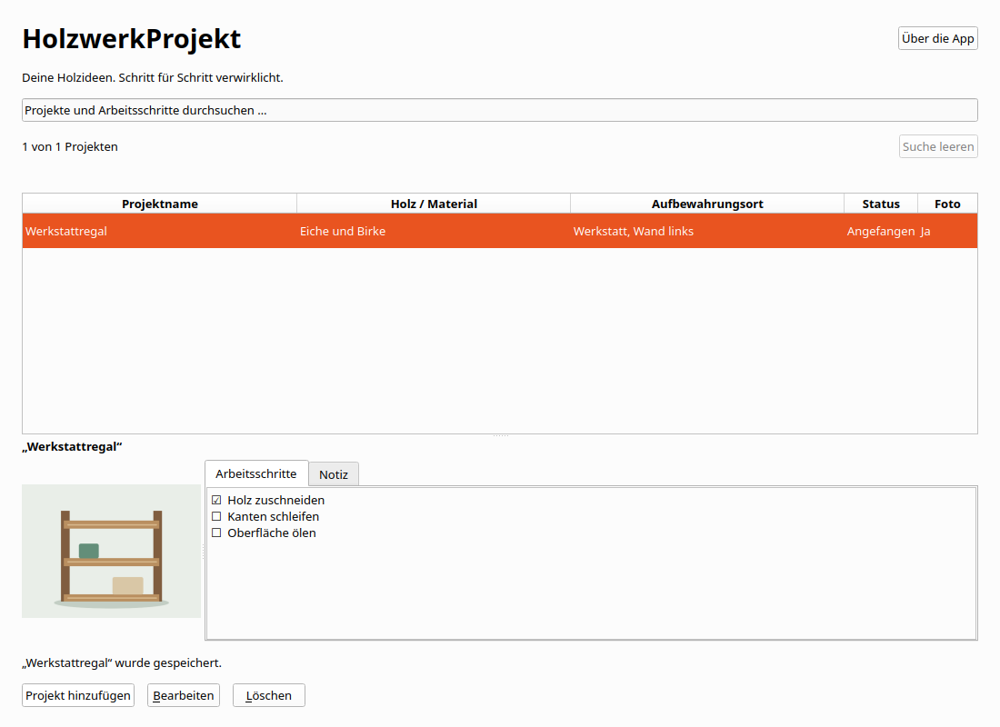

# Woodworking Projects

## Sammlung, Information und Sprache

Hinzufügen steht oben rechts. Unter der Tabelle stehen Bearbeiten und Löschen.
Die Spaltenüberschriften sortieren auf- und absteigend. Textspalten verwenden die
aktuelle Sprache und eine natürliche Zahlenreihenfolge. Status folgt der Reihenfolge
geplant, angefangen, fertig. Die Auswahl bleibt erhalten.

Info enthält getrennte Fenster für Über die App, Datenschutz und Lizenzen.
Alle Inhalte sind offline verfügbar. Neue Installationen verwenden die unterstützte
Systemsprache mit Englisch als Fallback. Gespeicherte Sprachwahlen bleiben erhalten.

Exportieren sichert die gesamte gespeicherte Sammlung als JSON mit eingebetteten
Originalfotos und allen vorhandenen Status- und Checklistendaten. Importieren ergänzt
fehlende Exemplare nach Bestätigung. Vorhandene Einträge werden nicht überschrieben.
Erneuter Import derselben Datei legt keine zusätzlichen identischen Exemplare an.
Exportdateien enthalten keine Spracheinstellung oder internen Eintrags-IDs.
Schrittkennungen, Reihenfolge und Erledigungsstand werden bei vorhandenen Checklisten
mitgesichert. Kollidierende Schrittkennungen werden beim Hinzufügen neu vergeben.

Eine Transferdatei darf höchstens 256 MiB und 10.000 Einträge enthalten.
Die bisherigen Fotogrenzen bleiben bestehen. Maximal 10.000 Schritte je Projekt
und eine Million Zeichen je Textfeld. Die Grenze verändert vorhandene Daten nicht.
Ein unvollständiger Import wird niemals gespeichert. Dateien anderer Apps und
unbekannte Formatversionen werden abgewiesen. JSON-Dateien sind nicht verschlüsselt.

Auf macOS wählst du erst einen Ordner und dann einen Dateinamen. Auf anderen
Plattformen öffnet sich der Speicherdialog. Vorhandene Dateien werden erst nach
Bestätigung und erneuter Prüfung ersetzt. Datenträger ohne Hardlinks werden für
neue Dateien unterstützt. Bei hartem Abbruch kann dort eine unvollständige neue
Datei zurückbleiben. Erstelle den Export dann erneut unter einem neuen Namen.


Deine Holzideen. Schritt für Schritt verwirklicht. Verwalte kleine private
Holzarbeiten mit Projektname, Holz oder Material, Aufbewahrungsort, mehrzeiliger
Notiz, einem optionalen Foto, Projektstatus und einer Checkliste.
Alles bleibt lokal, ohne Konto und Internet.



Version 0.1.0 ist die vierte kleine C++-App des Hobby-Portfolios und ein
nachvollziehbares Bewerbungsprojekt. Gegenüber Stufe 3 kommt genau eine
Hauptfunktion hinzu: die Checkliste. Veröffentlichungsziele sind ausdrücklich
**zuerst Microsoft Store, später Mac App Store für Mac-Computer**.
Es wurde nichts veröffentlicht oder bei einem Store eingereicht.

## Entwickeln und starten

C++20, Qt 6.8.3 Widgets, CMake ab 3.25, Ninja, Qt SQL mit QSQLITE und Qt Test.
Lokal verwendete Kombination: Ubuntu 24.04.4 x64, GCC 13.3.0, CMake 4.4.4,
Ninja 1.11.1, clang-format 23.1.3 und clang-tidy 22.1.8. Alle Qt-Komponenten und
Plugins müssen zum selben SDK und zur Compiler-ABI gehören. Qt wird dynamisch
unter der gewählten kostenfreien LGPL-Basis eingebunden.

Linux und macOS:

```bash
export HOLZWERKPROJEKT_QT_ROOT=/absoluter/pfad/Qt/6.8.3/gcc_64
source scripts/env.sh
cmake --preset dev
cmake --build --preset dev --parallel 4
bash scripts/run.sh --data-dir /tmp/holzwerkprojekt-test
```

Unter Linux öffnet `build/dev/holzwerkprojekt` die normale eigene Sammlung.
Für native Linux-Dateidialoge `QT_QPA_PLATFORMTHEME=gtk3` verwenden.
Wenn der Plattformhelfer fehlt, stellt Qt seinen Dateidialog bereit.
Windows und macOS verwenden ihre Systemdialoge.
Auf macOS zeigt der SDK-Pfad auf `macos`. Der Launcher befindet sich unter
`build/dev/holzwerkprojekt.app/Contents/MacOS/holzwerkprojekt`.

Windows in einer x64-Developer-PowerShell von Visual Studio 2022:

```powershell
$env:HOLZWERKPROJEKT_QT_ROOT = 'C:\Qt\6.8.3\msvc2022_64'
$env:CMAKE_PREFIX_PATH = $env:HOLZWERKPROJEKT_QT_ROOT
$env:PATH = (Join-Path $env:HOLZWERKPROJEKT_QT_ROOT 'bin') + [IO.Path]::PathSeparator + $env:PATH
cmake --preset dev
cmake --build --preset dev --parallel 4
.\build\dev\holzwerkprojekt.exe
```

`.tools/env.sh` darf lokale Werkzeugpfade enthalten und ist ignoriert.
Ein vorhandenes Qt-SDK kann zur Entwicklung mehrerer Apps dienen.
Die fertige App hat eigene Quellen, Git-Historie, Daten und Laufzeitpakete.
Es gibt keine gemeinsame Runtime oder Datenübernahme anderer Portfolio-Apps.

## Bedienung

„Projekt hinzufügen“ und „Bearbeiten“ öffnen denselben Dialog.
Nur der Projektname ist erforderlich. Neue Projekte sind **Geplant** und
haben weder Foto noch Arbeitsschritte. Gleichnamige Projekte sind unabhängig.
Bearbeiten und Löschen verwenden interne IDs. Löschen verlangt eine Bestätigung
und entfernt nur das gewählte Projekt einschließlich Foto und Arbeitsschritten.

Die Statusauswahl hat genau drei Werte: **Geplant**, **Angefangen**, **Fertig**.
Alle Wechsel sind direkt und in beide Richtungen erlaubt. Der Status verändert
keine Häkchen. Alle Schritte abzuhaken setzt den Status nicht automatisch auf
Fertig. Ein fertiges Projekt darf offene Schritte oder eine leere Checkliste haben.

„Arbeitsschritt hinzufügen“ hängt eine neue offene Zeile an. Text direkt eingeben
oder umbenennen, Kästchen abhaken oder wieder öffnen und Zeilen entfernen.
Jede Zeile besitzt bereits im Entwurf eine stabile UUID. Gleichlautende Texte
sind erlaubt. Entfernen erhält Reihenfolge und IDs der übrigen Schritte.
Leere oder nur aus Unicode-Leerraum bestehende Schritttexte müssen vor Speichern
korrigiert oder entfernt werden. Die Fehlermeldung nennt die betroffene Zeile.
Alle Eingaben bleiben erhalten. Eine vollständig leere Checkliste ist gültig.

**Erst Speichern übernimmt Texte, Foto, Status und Schritte gemeinsam.**
Abbrechen, Escape und Fensterschließen schützen auch reine Foto-, Status- oder
Häkchenänderungen. „Weiterbearbeiten“ ist die sichere Vorauswahl.
Ein Speicherfehler erhält den vollständigen Entwurf und erlaubt einen erneuten
Versuch. Während Import und Speichern sind konkurrierende Aktionen gesperrt.
Unveränderte oder vollständig zurückgesetzte Entwürfe schließen ohne Rückfrage.

Die Hauptansicht zeigt das gespeicherte Foto sowie die lesenden Register
„Arbeitsschritte“ und „Notiz“. Die vollständige Notiz bleibt scrollbar.
Die Suche erfasst alle vier Projekttextfelder und sämtliche Schritttexte.
Sie berücksichtigt Groß- und Kleinschreibung, Umlaute sowie zusammengesetzte
und zerlegte Unicode-Schreibweisen. Mehrere passende Schritte ergeben nur einen
Projekttreffer. Eine leere Suche zeigt alles. Nach Speichern außerhalb der
aktuellen Suche erklärt ein Hinweis, wo der gespeicherte Eintrag zu finden ist.

## Ein Foto

Die native Dateiauswahl erlaubt genau ein JPEG oder PNG. Hinzufügen, Ersetzen
und Entfernen betreffen zunächst den Entwurf. Die App prüft den tatsächlichen
Inhalt und decodiert das Bild vollständig. Abbruch und Importfehler erhalten den
vorigen Stand. Die Originaldatei wird nie verändert oder gelöscht.
Eine eigene Kopie der Bytes liegt in SQLite. Das Foto bleibt nach Entfernen der
Quelle und nach Neustart verfügbar.

Grenzen: **10 MiB**, **6000 Pixel je Seite**, **16 Millionen Pixel insgesamt**.
Animierte PNG-Dateien werden abgewiesen. Die proportionale Vorschau berücksichtigt
vom Qt-Decoder unterstützte Orientierung. Besondere Farbprofile werden nicht
zusätzlich aufbereitet. Keine Galerie, Bildbearbeitung, OCR oder Bilderkennung.

## Tastatur und kleine Fenster

| Taste | Aktion |
| --- | --- |
| Strg+N / Cmd+N | Projekt hinzufügen |
| Strg+F / Cmd+F | Suche auswählen |
| Enter oder Doppelklick in der Projektliste | Bearbeiten |
| Entf in der Liste, Cmd+Rücktaste auf macOS | Löschbestätigung |
| Strg+S / Cmd+S | Gesamten Dialog speichern |
| Escape | Dialogabbruch mit Verwerfschutz |
| Enter im Notizfeld | Neue Zeile |
| Leertaste auf einem Kästchen | Abhaken oder wieder öffnen |
| Leertaste auf einer Schrittaktion | Hinzufügen oder Entfernen |
| Tab / Umschalt+Tab | Nächstes / vorheriges Bedienelement |

Unter Linux und Windows fokussiert Alt+C die Checkliste, Alt+Z ergänzt eine Zeile.
Alt+P, Alt+M, Alt+A, Alt+S und Alt+N führen zu Projektname, Material, Ort, Status und
Notiz. Alt+F öffnet die Fotoauswahl. Das Formular scrollt auch bei vielen Schritten
und vergrößerter Schrift. Speichern und Abbrechen bleiben außerhalb des Scrollbereichs.

## Lokale Daten und Sicherung

App-Kennung: `de.appfabrik.holzwerkprojekt`.
`holzwerkprojekt.sqlite3` enthält Projekte, Fotobytes und Schritte.
QStandardPaths ermittelt das eigene Benutzerverzeichnis. „Über die App“ zeigt den
tatsächlich verwendeten Pfad. Typische Pfade ohne Store-Sandbox:

| System | Verzeichnis |
| --- | --- |
| Linux, hier geprüft | `$XDG_DATA_HOME/de.appfabrik.holzwerkprojekt`, sonst `~/.local/share/de.appfabrik.holzwerkprojekt` |
| Windows, nativ noch zu prüfen | `%LOCALAPPDATA%\de.appfabrik.holzwerkprojekt` |
| macOS, nativ noch zu prüfen | `~/Library/Application Support/de.appfabrik.holzwerkprojekt` |

Sandbox und Paketvirtualisierung können diese Pfade ändern.
Nutzerdaten liegen außerhalb des Programm- und Quellverzeichnisses.
Zum manuellen Sichern die App schließen und die SQLite-Datei kopieren.
`collection.lock` ist keine Nutzerdatenbank. Eine zweite App-Instanz derselben
Sammlung wird abgewiesen. Andere eigenständige Apps können parallel laufen.
Externe gleichzeitige Datenbearbeitung wird nicht unterstützt.
SQLite kann freien Platz intern behalten. Eine sofortige Dateiverkleinerung
oder sichere physische Löschung entfernter Bilder wird nicht zugesagt.

`--data-dir` muss absolut und nicht leer sein. Ungültige Pfade fallen niemals
auf normale Benutzerdaten zurück. Tests verwenden nur temporäre Datenbanken
und synthetische Bilder.

## Prüfen und verstehen

```bash
source scripts/env.sh
bash scripts/check.sh
ASAN_OPTIONS=detect_leaks=1:halt_on_error=1 UBSAN_OPTIONS=halt_on_error=1 bash scripts/check.sh asan
DISPLAY=:0 python3 scripts/gui_smoke.py --binary build/dev/holzwerkprojekt --output build/manual/dev-visible
```

Bei unzuverlässiger Desktop-Eingabe bietet `scripts/visible_desktop.py` einen
eigenen sichtbaren Xephyr mit Openbox. Aufruf und Nachweise stehen im Prüfbericht.

Der sichtbare Helfer hält auf DISPLAY=:0 automatisch die gemeinsame UI-Sperre
und bedient nur selbst gestartete Fenster. [Prüfbericht](docs/verification.md),
[Architektur und Interviewerklärung](docs/architecture.md),
[Paketierung](docs/packaging.md) und [Lizenzhinweise](THIRD_PARTY_NOTICES.md)
beschreiben Nachweise und Grenzen.

| Stufe | Eigenständige App | Neue Hauptfunktion |
| --- | --- | --- |
| 1 | BrettspielRegal | Anlegen, Bearbeiten, Löschen, Suchen |
| 2 | SammlerVitrine | Ein Foto |
| 3 | ModellbauProjekt | Projektstatus |
| 4 | Woodworking Projects | Checkliste |
| 5, Reserve | RestaurierungsHeft | PDF-Export |

Jede Stufe behält die vorherigen Grundfunktionen. RestaurierungsHeft bleibt
Reserve und wird hier nicht implementiert. FactoryForge und PDF Batch Studio
bleiben separate größere Projekte. Keine Kostenplanung, Werkzeugbestände,
Fristen, Unteraufgaben, Fortschrittswerte, PDF-Funktionen oder Cloud-Anbindung.

## Sprachen und Store-Vorschau

Deutsch, Englisch, Spanisch, Französisch, Italienisch und brasilianisches
Portugiesisch sind unter „Sprache“ wählbar. Die Auswahl gilt ab Neustart.
Bestandsdaten, Fotos und Checklisten bleiben erhalten. Sechs Store-Textfassungen
und echte Linux-Vorschauen werden als Ordner geliefert.
Siehe [Internationalisierung](docs/internationalization.md).
Windows-Abnahme und Einreichung bleiben gesondert.

## JSON-Austauschformat

Formatkennung `woodworking-projects.collection`, Version `1`, Eintragsliste `projects`.
Jeder Eintrag enthält `name`, `material`, `location`, `note` und `photoBase64`.
Ohne Foto ist `photoBase64` null, sonst enthält es die ursprünglichen Bildbytes
als kanonisches Base64. Interne Eintrags-IDs sind nicht Bestandteil des Formats.
Status wird als `status` mit `planned`, `started` oder `finished` gespeichert.
`steps` enthält `id`, `text`, `completed` und `position` je Arbeitsschritt.
Schrittpositionen müssen als JSON-Zahlen exakt darstellbar sein.
Dateien anderer Produkte, unbekannte Versionen und ungültige Felder werden
abgewiesen. Der bestätigte Import verwendet einen bereits validierten Snapshot.
