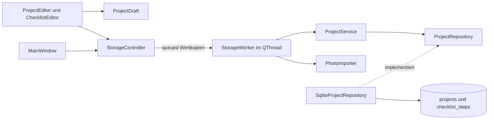

# Architektur und Bewerbungsgespräch

Ein CMake-Projekt mit vier kleinen internen Targets trennt Modell/Service,
Fotoimport, SQLite und Oberfläche. Qt Core-Werttypen sind erlaubt.
Repository-Vertrag und Fachlogik kennen keine Widgets, SQL bleibt in der
Persistenz. Es gibt weder Plugin-Architektur noch gemeinsamen Portfolio-Core.
BrettspielRegal diente als geprüfte strukturelle Grundlage. Die unabhängig
entwickelten Foto- und Statusmuster der parallelen C++-Apps wurden gelesen und
app-lokal angepasst. Ihre Prüfbehauptungen wurden nicht übernommen.
NähPlan war das fachliche Vorbild für Schritte und Mehrtabellen-Transaktionen.

## Identität und Werte

`WoodProject` trägt eine 64-Bit-Projekt-ID. SQLite erzeugt sie mit
`INTEGER PRIMARY KEY AUTOINCREMENT`. Gleiche Namen dürfen vorkommen.
Mutationen verwenden die ID und niemals Namen oder sichtbaren Listenindex.
`ProjectDraft` enthält vier QString-Werte, Status, Fotobytes und eine Liste von
`ChecklistStep`. Leere Fotobytes bedeuten kein Foto.

Ein Schritt enthält `QUuid id`, `QString text`, `bool completed` und
`qint64 position`. Die UUID entsteht beim Hinzufügen zum Entwurf.
Umbenennen, Abhaken und Speichern erhalten sie. UI-Callbacks entfernen über die
gefangene UUID. Nach Entfernen einer mittleren Zeile wirken Aktionen deshalb
weiter auf den richtigen Schritt. Gleiche Texte sind unabhängig.

**Positionslücken bleiben bestehen.** Neue Zeilen erhalten die Position hinter
der letzten verbleibenden Zeile. Positionen sind streng aufsteigend,
nicht negativ und pro Projekt eindeutig. Entfernen ändert keine IDs oder
Positionen der übrigen Zeilen. Es gibt keine manuelle Umsortierung.

| enum class ProjectStatus | Speicherwert | Anzeige |
| --- | --- | --- |
| Planned | planned | Geplant |
| Started | started | Angefangen |
| Finished | finished | Fertig |

Die Funktionen `storedStatus`, `statusFromStorage` und `displayStatus` ordnen
explizit zu. Implizite Enum-Reihenfolge und Übersetzungen gelangen nicht in SQLite.
Ungültige Werte werfen verständliche Fehler. Die ComboBox ist nicht editierbar.
Neue Projekte sind Planned. Jede Änderung ist frei, ohne Abhängigkeit zu Häkchen.

Einzeilige Projektfelder werden außen getrimmt. Schritttexte müssen zusätzlich
einzeilig und nach Unicode-Trim nicht leer sein. Die Notiz wird nicht getrimmt.
Der Qt-Klartexteditor verwendet LF-Zeilenumbrüche. Suche normalisiert nach NFC,
wendet Unicode-Case-Folding und erneut NFC an. Das gilt für sämtliche Projekt-
und Schritttexte. Ein deutscher QCollator mit natürlicher Zahlensortierung und
ID als Gleichstandsregel liefert eine stabile Reihenfolge. Jedes Projekt wird
höchstens einmal übernommen, wenn irgendein Feld oder Schritt passt.

## Ein gemeinsamer Entwurf

Der Editor hält den Ausgangswert und die aktuellen rohen Werte.
Neue Schritttexte dürfen während der Eingabe leer sein. Erst Speichern validiert
alle Werte. Bei Fehler bleiben Texte, Häkchen, UUIDs, Positionen, Status und
Fotoentwurf erhalten. Die Meldung nennt die sichtbare Schrittzeile.

Wertgleichheit vergleicht alle Felder, einschließlich Fotobytes und Schrittliste.
Sie schützt reine Häkchenänderungen genauso wie Text-, Status- und Fotoänderungen.
Ein gleicher Dateiname ist unerheblich. Wird der gesamte Wert wiederhergestellt,
entfällt die Rückfrage. Abbrechen, Escape, Dialogschließen und Hauptfensterschließen
verwenden denselben Verwerfschutz mit „Weiterbearbeiten“ als Standard und Escape-Aktion.

Der Hauptbereich zeigt ausschließlich gespeicherte, lesende Daten.
Es gibt keine zweite Checklistenbearbeitung oder sofortige Häkchenspeicherung.
Die scrollbare Dialogform hält Fotoaktionen und viele Schritte erreichbar.
Die Dialogschaltflächen liegen außerhalb des Scrollbereichs.

## Transaktion über zwei Tabellen

Schema 1 und die eigene SQLite-`application_id=1213681713` kennzeichnen die Datei.
`projects` enthält Texte, Status und optionalen Foto-BLOB.
`checklist_steps` besitzt UUID-Primärschlüssel, `project_id` als Fremdschlüssel,
Text, Boolean als INTEGER 0/1 und explizite Position.
NOT NULL, CHECK, UNIQUE und ON DELETE CASCADE schützen die Wertebereiche.
Jede Repository-Verbindung aktiviert und kontrolliert `PRAGMA foreign_keys=ON`.

Ein Speichervorgang auf derselben Verbindung:

1. Entwurf und vollständige Bildbytes validieren.
2. Eine explizite SQLite-Transaktion beginnen.
3. Projektzeile anlegen oder per ID ändern.
4. Bisherige Schrittzeilen dieses Projekts entfernen.
5. Vollständige kleine Schrittliste mit unveränderten UUIDs einfügen.
6. Commit abschließen und erst jetzt den bestätigten Datensatz zurückmelden.

Die vollständige Ersetzung der kleinen Liste ist absichtlich einfach.
Ein RAII-`Transaction` rollt jeden vorzeitigen Ausgang zurück, auch wenn ein
späteres INSERT oder erst der Commit scheitert. Die Tests legen einen echten
SQLite-Trigger auf den zweiten Schritt-INSERT. Sie belegen den Rollback aller
Projektfelder, Fotobytes, Statuswerte und Schritte. Ein fehlgeschlagenes Anlegen
hinterlässt weder Projekt- noch Schrittteilzeilen. Nach Entfernen des Triggers
gelingt derselbe Entwurf. Ein bloßer vorgezogener Mockfehler würde das nicht beweisen.

Parametrisierte SQL-Anweisungen binden auch Schritttexte und UUIDs.
Anführungszeichen und SQL-ähnliche Texte bleiben Daten.
Projektlöschung entfernt Foto und Schritte atomar per Fremdschlüssel-Kaskade.
Andere gleichnamige Projekte bleiben erhalten.

Listen- und Detailabfrage lesen Projektzeilen und Schritte in einer gemeinsamen
Lesetransaktion. Listen enthalten keine Fotobytes, nur eine Foto-Kennzeichnung.
Die Auswahl lädt den vollständigen Stand bedarfsgerecht. Auch ohne Foto wird vor
Bearbeitung eine konsistente Detailabfrage durchgeführt. Ein Foto- oder Lesefehler
öffnet keinen leeren Ersatzentwurf. Unbekannte Statuswerte, beschädigte Schrittwerte,
UUIDs und Reihenfolgen werden gemeldet und nicht still repariert.

Vorhandene leere, beschädigte, fremde und neuere Datenbanken werden abgewiesen.
App-ID, exakte bekannte Tabellenstruktur, Integritäts- und Fremdschlüsselprüfung
sichern das Öffnen ab. Die Datei wird nicht durch eine leere Sammlung ersetzt.
Ein QLockFile im kanonischen Datenverzeichnis verhindert eine zweite App-Instanz.
Externe gleichzeitige Bearbeitung ist kein unterstützter Ablauf.

## Fotoimport und begrenzte Speicherbelegung

Die native Dateiauswahl liefert einen nur vorübergehend benötigten Pfad.
Der Import öffnet ausschließlich lesend und liest höchstens 10 MiB plus ein
Prüfbyte in Blöcken. Nachträgliches Dateiwachstum umgeht die Grenze nicht.
QImageReader erkennt den Inhalt. Nur JPEG und PNG sind zulässig.
Abmessungen werden vor vollständigem Decodieren geprüft: 6000 Pixel je Seite,
16 Millionen Pixel insgesamt. Das Pixelprodukt wird mit 64 Bit berechnet.

PNG-Chunklängen, CRCs und IEND werden zusätzlich geprüft. Animierte PNGs werden
abgewiesen. JPEG benötigt vollständige Einrahmung. Ein mutexgeschützter
Diagnose-Scope behandelt Decoderwarnungen im aktuellen Thread als Importfehler,
weil der JPEG-Decoder manche Beschädigungen sonst repariert. Andere Meldungen
werden an den vorherigen Qt-Handler weitergegeben. Die App installiert keine
konkurrierenden Diagnose-Handler.

Erst vollständige erfolgreiche Decodierung erzeugt eine QImage-Vorschau bis
1000 Pixel je Seite. Die Originalbytes bleiben unverändert im BLOB.
`setAutoTransform(true)` berücksichtigt unterstützte EXIF-Orientierung.
Die GUI stellt proportional dar und erzeugt QPixmap nur im GUI-Thread.
Ein 16-Megapixel-Bild benötigt etwa 64 MiB bei 32 Bit oder 128 MiB bei 64 Bit
pro Pixel, zuzüglich Decoderpuffern und Vorschau. Qt kann wegen seines eigenen
Allokationslimits früher ablehnen. Es gibt keine zusätzliche Farbprofilaufbereitung
und keine Decoder-Sandbox. Bildinhalte werden nicht semantisch geprüft.

## RAII, Besitz und Threads

Qt-Parent-Ownership verwaltet Widgets. `MainWindow` hält den Editor als QPointer.
`StorageController` besitzt einen QThread. Der Worker wird vor Arbeitsbeginn
dorthin verschoben und am Threadende im eigenen Thread freigegeben.
Er besitzt das Repository mit `std::unique_ptr`. Die SQL-Verbindung entsteht,
arbeitet und endet ausschließlich im Worker. Lokale QSqlQuery-Werte geben
Abfragen zuverlässig frei. Beim Abbau verschwinden Handles vor dem Entfernen
der benannten Qt-Verbindung.

Ein Worker ordnet Datenbank-, Import- und Decoderaufgaben seriell.
Die auf zwei Sekunden begrenzte SQLite-Sperrwartezeit blockiert keine Widgets.
Queued Signale transportieren Wertkopien. QString und QByteArray verwenden
Copy-on-write. Konstante Referenzen dienen zum Lesen innerhalb einer Schicht.
Doppelaktionen während Import und Speichern bleiben gesperrt.

Jeder Auswahlwechsel erhöht einen Generationstoken. Ein verspätetes Ergebnis
wird nur übernommen, wenn Token und Projekt-ID noch passen. Empfänger-Kontexte
trennen Signale automatisch bei Fensterzerstörung. Ein verworfener Editor hat
keine wirksamen Importcallbacks mehr. Ein neuer Editor übernimmt keine fremden
späten Ergebnisse. Der Controller beendet seinen Thread geordnet.
Sehr schnelle Auswahlwechsel können die serielle Warteschlange verlängern.
Für kleine private Sammlungen ist das der bewusst überschaubare Ansatz.

## Im Bewerbungsgespräch

„Projekt und Checkliste sind eine Eins-zu-viele-Beziehung. Jedes Element hat
eine stabile Identität. Der Dialog ist ein vollständiger Wertentwurf. Eine
Transaktion speichert beide Tabellen, und ein echter später SQL-Fehler beweist
den Rollback. Status ist ein typisierter Wertebereich mit stabilen Schlüsseln.
Ein Worker hält SQLite und Decoder von Widgets getrennt. Generationstokens
verhindern, dass verspätete Fotos zur falschen Auswahl erscheinen.“

Die Tests verwenden temporäre Datenbanken und erzeugte Bilder.
Sie prüfen Fachregeln, reale Sperren, Commit- und späte INSERT-Fehler sowie
echte Qt-Dialoge. Sichtbare Pakettests ergänzen die Automatisierung.

Offizielle Grundlagen:
[SQLite-Transaktionen](https://www.sqlite.org/lang_transaction.html),
[Fremdschlüssel](https://www.sqlite.org/foreignkeys.html),
[QImageReader](https://doc.qt.io/qt-6.8/qimagereader.html),
[Qt SQL und Threads](https://doc.qt.io/qt-6.8/threads-modules.html#threads-and-the-sql-module).

## Sprachen

App-lokale TS-Kataloge werden mit Qt Linguist in die Laufzeit eingebettet.
`Translations` installiert App- und Qt-Basistexte vor Fenstern und Worker.
`LanguageDialog` speichert über den vorhandenen Worker mit QSaveFile.
QLocale steuert Zahlen und Sortierung. Die Wahl bleibt pro Prozess unverändert.
Es gibt keine Datenmigration oder Änderung an Schema, Schritten und Fotobytes.
